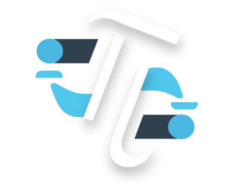

# Mohammed · `<moha />`

### Front-End Developer · Next.js & React · CS Student

🟢 **Open to internships, junior/intermediate front-end roles, and freelance projects**

<!-- Add this line if you create a LinkedIn:

-->

---

## 💫 About Me

- 🎓 Studying Computer Science, and building websites is my hobby too.
- 💻 I build responsive, animated websites with Next.js, React, and TypeScript.
- 🏢 Founder and lead front-end developer at **PIT**, a small team.
- 🧩 Practicing problem solving on LeetCode and Codewars.
- ☕ They say developers are boring, have I changed your mind?
  
---

## 🚀 Featured Projects

| Project | Description | Links |
|---------|-------------|-------|
| 🌸 **Fragrant Flower** | A Waguri fan website with animated sections, an album slider, and a character timeline. Built with Next.js, React, and TypeScript. | [Live](https://ff-weld-ten.vercel.app) · [Code](https://github.com/Mohammed79-stack/fragnentflower) |
| 🍮 **B.Laban Concept** | An unofficial UI recreation of a dessert brand website, built for portfolio practice. Not affiliated with the brand. | [Live](YOUR_BLABAN_LIVE_LINK) · [Code](https://github.com/Mohammed79-stack/YOUR_BLABAN_REPO) |

---

## 🛡️ My Team

<table>
<tr>
<td width="120" align="center">

</td>
<td>

**[PIT (بِـٍـت)](https://pit-ecru.vercel.app/)** is a small team of three, covering front-end development, full-stack systems, and creative direction, designing.

I'm the **founder and lead front-end developer**, building modern websites with a focus on designs.

[🌐 Visit the PIT website](https://pit-ecru.vercel.app/)

</td>
</tr>
</table>

---

## 💻 Tech Stack

**Languages**

**Frameworks & Build Tools**

**Tools & Hosting**

**Design**

**Also familiar with:** OpenGL

---

## 🧩 Problem Solving

---

☕ Like my work? You can buy me a coffee

<!-- Proudly created with GPRM ( https://gprm.itsvg.in ) -->
